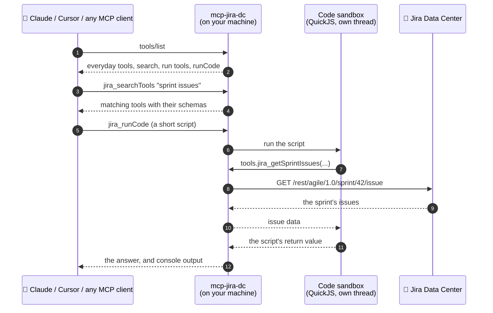

# Atlassian Data Center MCP

[](https://www.npmjs.com/package/mcp-jira-dc)
[](https://www.npmjs.com/package/mcp-confluence-dc)
[](https://www.npmjs.com/package/mcp-bitbucket-dc)
[](https://github.com/tekthar/atlassian-data-center-mcp/actions/workflows/ci.yml)
[](https://github.com/tekthar/atlassian-data-center-mcp/blob/main/LICENSE)
[](https://scorecard.dev/viewer/?uri=github.com/tekthar/atlassian-data-center-mcp)

**The leading MCP for Atlassian Data Center, built for AI-first companies that run Jira, Confluence and Bitbucket on
their own servers.**

Your teams chose Data Center for control over their data. They shouldn't have to give up the best AI models to keep
it. Three [Model Context Protocol](https://modelcontextprotocol.io) (MCP) servers let Claude, Cursor and any other MCP
client work in your self-hosted Atlassian tools: search and update issues, read and write pages, review pull requests,
without flooding the model's context. Each is one `npx` command. Your agent signs in with your personal access token, so it can do what you can, and nothing
more.

```bash
npx -y mcp-jira-dc setup                    # ← saves your Jira address and token
claude mcp add jira -- npx -y mcp-jira-dc   # ← connects Claude Code
```

Claude now sees 14 Jira tools: the everyday ones for issues, comments and transitions, plus a search that reaches 43
more when it needs them, and a sandbox where it can combine many reads into one answer.

> A community project. Not affiliated with or endorsed by Atlassian. Jira, Confluence and Bitbucket are trademarks of
> Atlassian.

## Why you'll like it

- **One command, nothing to host**: `npx` runs each server on your machine. No Python, no Docker, no server to run.
  Built for Data Center and Server, the editions Atlassian's own MCP server doesn't cover.
- **A small tool list, with nothing out of reach**: every listed tool costs tokens in every request, so the everyday
  tools are listed and the rest wait behind a search. The agent sees 14 Jira tools instead of 61, and can still use all
  of them.
- **Answers, not pages of JSON**: for a question that takes many calls, the agent writes a short script that makes the
  calls in a sandbox and returns only the answer. One example below returns 226 characters instead of 1,215.
- **Only the tools you can use**: at startup the Jira server reads your permissions and hides what your account could
  never run.
- **Writes stay visible**: every tool tells the client whether it reads, changes or deletes, so the client can ask you
  first. Scripts can only read, and deleting always needs a setting you turn on.
- **An audit trail when you need one**: turn on the audit log to record every tool the agent calls, including the ones
  it reaches through the search or from a script, without recording what it read or wrote.
- **Locked down when you need it**: read-only mode, an exact tool allowlist, merges only on the repositories and target
  branches you name, and attachments only inside folders you name.
- **Credentials in the right place**: `setup` checks your token against the server, then stores it in your OS keychain
  (macOS Keychain, Windows Credential Manager, or the Linux desktop keyring), or in a file only your user can read.
  The token is masked in everything the servers write.

## Why run it on your machine?

Data Center usually lives behind a firewall or a VPN. A server that runs where you work reaches it the way your
browser does.

| | A hosted MCP connector | **These servers** |
|---|---|---|
| Reaches instances behind your firewall or VPN | only if the instance is exposed to the service | **yes**: wherever your machine can reach |
| Where your token lives | with the service | **on your machine**: your OS keychain, or a file only your user can read |
| Who decides which tools the agent sees | the service | **you**, with a few settings |
| Something to host, approve or pay for | the service | **nothing**: `npx` runs it |

[Atlassian's official MCP server](https://github.com/atlassian/atlassian-mcp-server) is a hosted server for Atlassian
Cloud. These servers are for Data Center and Server.

## The three servers

| Server | npm package | What the agent can do |
|---|---|---|
| **Jira** | [`mcp-jira-dc`](https://www.npmjs.com/package/mcp-jira-dc) | Search with JQL, create, update and transition issues, comments, links, versions, sprints, worklogs, service desk queues, fields and users. 63 tools in 18 toolsets, plus Xray test management when it's installed. |
| **Confluence** | [`mcp-confluence-dc`](https://www.npmjs.com/package/mcp-confluence-dc) | Search with CQL, read, create and update pages, page trees, version history and diffs, labels, comments, restrictions and attachments. 26 tools in 11 toolsets. |
| **Bitbucket** | [`mcp-bitbucket-dc`](https://www.npmjs.com/package/mcp-bitbucket-dc) | Browse projects, repositories, files, branches and commits, search code, and review and comment on pull requests. Merging and declining are opt-in. 27 tools plus 2 opt-in. |

Install only the ones you use. They share one configuration format, so a single settings file can serve all three.

## Supported apps

The servers also have tools for these Marketplace apps:

| App | Server | Versions | Status |
|---|---|---|---|
| Xray, test management | Jira | 8 | Beta |
| ScriptRunner, scripting and automation | Jira | 9 | Beta |
| Jira Service Management | Jira | not recorded | Beta |
| draw.io, diagrams | Confluence | 16 | Beta, read-only so far |

Beta means built and checked, but not yet run against a live instance of the app. [Supported apps](docs/supported-apps.md) lists the
exact versions each app's tools were built from and how they were checked.

## Install

```bash
npx -y mcp-jira-dc setup
```

Requires Node.js 22.22.2 or later, a Data Center or Server instance, and a personal access token. Swap in
`mcp-confluence-dc` or `mcp-bitbucket-dc` for the other servers.

## Crash course

### 1. Save your address and token

`setup` asks for your host and token, makes one authenticated request to check them, and saves them:

```bash
npx -y mcp-jira-dc setup
```

To create a token in Jira or Confluence, open your profile picture, then **Personal Access Tokens** > **Create token**.
In Bitbucket it's **Manage account** > **HTTP access tokens**. In scripts and CI, `setup --non-interactive` takes
everything as flags and exits non-zero when the token doesn't work.

### 2. Connect your agent

`install` registers the server with [Claude Code](https://claude.com/claude-code) or Claude Desktop for you:

```bash
npx -y mcp-jira-dc install --claude-code      # runs claude mcp add
npx -y mcp-jira-dc install --claude-desktop   # edits Claude Desktop's config, after backing it up
```

Cursor, VS Code and other clients with an `mcpServers` file:

```json
{
  "mcpServers": {
    "jira": { "command": "npx", "args": ["-y", "mcp-jira-dc"] },
    "confluence": { "command": "npx", "args": ["-y", "mcp-confluence-dc"] },
    "bitbucket": { "command": "npx", "args": ["-y", "mcp-bitbucket-dc"] }
  }
}
```

Then ask something like *"Which issues in our current sprint are blocked, and who owns them?"*

### 3. Choose what's listed

Every setting is optional. Unset, Jira and Confluence list their everyday tools and offer the rest through the search.

| Setting | What it does |
|---|---|
| `TOOLSETS` | Lists whole toolsets directly, e.g. `default,jira_agile` for a team that lives in sprints. `all` lists everything. |
| `READ_ONLY_MODE=true` | Offers only tools that never change anything. |
| `ENABLED_TOOLS` | An exact allowlist of tool names, for locked-down setups. |
| `TOOL_GATEWAY=off` | Turns the search off: tools outside the selected toolsets are left out. |
| `CODE_EXECUTION=off` | Removes the code sandbox. |
| `PERMISSION_FILTER=off` | Lists Jira tools without checking your permissions first. |
| `ATLASSIAN_DC_MCP_AUDIT=1` | Keeps an audit log: one line per tool call, with the tool, outcome and duration, never the arguments or results. Tools run through the search or from code are recorded too. |

Each server's README lists its toolsets and the settings that turn on risky tools:
[Jira](packages/jira/README.md), [Confluence](packages/confluence/README.md),
[Bitbucket](packages/bitbucket/README.md).

### 4. Check your setup

`doctor` checks each step in turn and says how to fix what's wrong. It starts the server the way your MCP client does,
so it shows exactly what the agent will get:

```text
$ npx -y mcp-jira-dc doctor
mcp-jira-dc doctor

✓ Node.js   22.22.2
✓ Settings  everything needed is set
            JIRA_HOST: jira.example.com, from C:\Users\alice\.atlassian-dc-mcp\jira.env
            JIRA_API_BASE_PATH: (not set)
            JIRA_API_TOKEN: ••••HcU1, from Windows Credential Manager
            JIRA_DEFAULT_PAGE_SIZE: 25 (default)
✓ Keychain  token kept in Windows Credential Manager
✓ Sign-in   signed in as Alice Smith (alice)
✓ Tools     11 listed, about 2,900 tokens of context
            32 more through jira_searchTools
            jira_runCode is on
            server: Permission filter hid 14 Jira tools: jira_transitionIssue, jira_linkIssues, ...
```

The token is masked, so the output is safe to paste into a bug report.

## What the agent sees

These are real responses from the Jira server, run against a test Jira. The tool list holds the everyday tools and four
more:

```text
jira_searchIssues, jira_getIssue, jira_getIssueComments, jira_createIssue, jira_updateIssue,
jira_postIssueComment, jira_updateIssueComment, jira_getTransitions, jira_transitionIssue,
jira_downloadAttachment, jira_searchTools, jira_runReadTool, jira_runWriteTool, jira_runCode
```

Asked about a sprint, the agent searches for a tool. `jira_searchTools` returns the matches with their input schemas
(left out here), and says whether each one reads or writes:

```json
[
  { "name": "jira_getSprintIssues", "toolset": "jira_agile", "access": "read",
    "description": "List the issues in a sprint in the JIRA Data Center edition instance, in rank order, optionally narrowed by JQL. Returns key, summary, status, type, priority and assignee per issue." },
  { "name": "jira_addIssuesToSprint", "toolset": "jira_agile", "access": "write",
    "description": "Move issues into a future or active sprint in the JIRA Data Center edition instance, taking them out of any other sprint. At most 50 issues per call." },
  { "name": "jira_moveIssuesToBacklog", "toolset": "jira_agile", "access": "write",
    "description": "Move issues to the backlog in the JIRA Data Center edition instance, removing them from their future or active sprint. At most 50 issues per call." }
]
```

It can run the read tool with `jira_runReadTool`, or, to answer the question in one step, write a script for
`jira_runCode`:

```js
const { issues } = await tools.jira_getSprintIssues({ sprintId: 42 });
const blocked = issues.filter((issue) => issue.status === 'Blocked');
console.log(`${blocked.length} of ${issues.length} issues are blocked`);
return blocked.map((issue) => `${issue.key} ${issue.summary} (${issue.assignee?.displayName ?? 'unassigned'})`);
```

```json
{
  "result": [
    "PAY-102 Migrate payouts to new ledger (Ben Okafor)",
    "PAY-104 Upgrade payment SDK (Amira Haddad)",
    "PAY-106 Refund API returns 500 on partial refunds (Ben Okafor)"
  ],
  "logs": ["3 of 7 issues are blocked"],
  "toolCalls": 1
}
```

That answer is 226 characters. The full sprint listing it came from is 1,215, and on a real sprint the gap grows with
every issue.

## How it works

Each server runs on your machine as a child process of your MCP client, and calls your Atlassian instance's REST API
with your token:



The script runs in [QuickJS](https://github.com/justjake/quickjs-emscripten), a JavaScript engine compiled to
WebAssembly, in its own worker thread. It can't reach the network, files or your processes, only the read tools. It is
stopped after 30 seconds or 50 tool calls, and if it crashes the engine, only that run fails.

### Compared with listing every tool

The same Jira server with `TOOLSETS=all`, against the defaults:

| | Defaults | Every tool listed |
|---|---|---|
| Tools in every request | 14 (about 13,900 characters of schema) | 61 (about 56,000 characters) |
| Reaching a less common tool | One search, then a call | A direct call |
| A question that takes many calls | One script, returning only the answer | One call per step, every result in context |
| Writes | One at a time, each visible to the client | One at a time, each visible to the client |
| Deleting | Only toolsets you turn on | Listed with everything else |

## What it guarantees

- **It never widens access.** Every request carries your token, so Jira, Confluence and Bitbucket decide what you can
  do. Hiding a tool trims what the agent sees; it never unlocks anything.
- **Scripts only read.** Code in the sandbox can call read tools and nothing else. Every change goes through a tool
  call your client can see and ask you about.
- **Deleting is always your decision.** The tool search never offers a tool that deletes, and the sandbox can't reach
  one. Delete tools appear only in toolsets you turn on, and some need their own setting too, like
  `JIRA_VERSION_DELETE_ENABLED`.
- **It never retries a call on its own.** If a request fails, the agent sees the error and decides what to do.
- **It never waits forever.** Every request to your instance times out after 30 seconds by default
  (`ATLASSIAN_DC_MCP_REQUEST_TIMEOUT_MS`), and every script after 30 seconds or 50 tool calls.
- **It stays out of your files.** Attachments are read from and saved to only the folders you name, and a saved file
  never overwrites an existing one.

Content in your instance is written by other people, so issue text, comments, pages and attachments reach the agent as
data, not instructions. Tool descriptions say so where it matters.

## How do we know it works?

An agent acts with your account, so a tool that does more than it says is a real problem. More than 1,000 automated
tests run on every pull request, on Ubuntu and on Windows:

- **Every tool is accounted for**: a tool missing from its server's catalog stops the server from starting. Tests check
  that read-only mode offers only read tools, that every Jira tool that changes data names the permission it needs
  (apart from the few anyone can run, like watching an issue yourself), and that the search never offers a destructive
  tool.
- **The sandbox is attacked on purpose**: tests try to reach `require`, `process` and the network, and run busy loops,
  promises that never settle, runaway recursion, a native stack overflow and unbounded memory. Each must fail cleanly
  while the server keeps working.
- **The shipped package is checked**: CI bundles each server the way npm receives it and loads the bundle, so a missing
  dependency fails the build, not your install.
- **Careful with dependencies**: every version is pinned exactly, new releases must be at least seven days old before we
  take them, and npm packages are published from CI with npm trusted publishing, with no long-lived token.
- **Scanned for security problems**: CodeQL checks the code and the workflows on every pull request, dependency review
  blocks a pull request that adds a dependency with a known vulnerability, Dependabot keeps dependencies and actions
  current, every action is pinned to a commit, and the [OpenSSF Scorecard](https://scorecard.dev/viewer/?uri=github.com/tekthar/atlassian-data-center-mcp)
  tracks the project against open-source security practices. [SECURITY.md](SECURITY.md) explains how to report a
  problem.

## Documentation

| Guide | What it covers |
|---|---|
| [Jira server](packages/jira/README.md) | Settings, the 18 toolsets, the permission filter, attachments, deleting versions |
| [Confluence server](packages/confluence/README.md) | Settings, the 11 toolsets, attachments |
| [Bitbucket server](packages/bitbucket/README.md) | Settings, the tools, allowing merges for named repositories |
| [Supported apps](docs/supported-apps.md) | The apps with tools, the exact versions they were built from, and how they were checked |
| [Configuration reference](docs/configuration.md) | Every `setup` flag, where credentials are stored, the order settings are read in, full client configurations |
| [Contributing](CONTRIBUTING.md) | Building and testing, how tool selection, the search and the sandbox work, releasing |
| [Changelog](CHANGELOG.md) | What each release changed |

## Status and roadmap

This is **0.47**, which added the token in the OS keychain on every platform, `doctor`, `install`, the audit log, and
Jira app support starting with Xray. The [changelog](CHANGELOG.md) lists every change and what to do when upgrading.
Until 1.0, minor versions may include breaking changes, and the changelog describes them. Coming next:

- more apps (plugins), reached through the tool search so they cost nothing until used. Xray was the first and
  ScriptRunner is under way; [Supported apps](docs/supported-apps.md#roadmap) has the order
- Jira administration tools

## Have a question? Want to help?

Questions, ideas and bug reports are welcome as [issues](https://github.com/tekthar/atlassian-data-center-mcp/issues). To contribute
code or docs, read the [contributing guide](CONTRIBUTING.md) first; everyone taking part follows the
[Code of Conduct](CODE_OF_CONDUCT.md). Please report security problems through
[private reporting](SECURITY.md), not in public issues.

Running a supported Jira app's tools against your own instance is one of the most useful contributions: it's what
moves an app from Beta to Tested. The **Jira app support** issue form asks for what we need.

Thank you to [everyone who has contributed](https://github.com/tekthar/atlassian-data-center-mcp/graphs/contributors),
and to the open-source projects this one builds on.

```
packages/jira/          mcp-jira-dc
packages/confluence/    mcp-confluence-dc
packages/bitbucket/     mcp-bitbucket-dc
packages/common/        shared code (configuration, setup, tool selection, the tool search, the code sandbox),
                        bundled into each server and never published on its own
scripts/                bundling, versioning and release scripts
docs/                   guides
```

To run the tests:

```bash
npm install
npm run build
npm test
```

## Credits and licence

MIT licence.

Parts of the code come from two MIT-licensed projects, [b1ff/atlassian-dc-mcp](https://github.com/b1ff/atlassian-dc-mcp)
and [sooperset/mcp-atlassian](https://github.com/sooperset/mcp-atlassian). Their notices are in [LICENSE](LICENSE).
Thank you to both. It is built on the official
[MCP TypeScript SDK](https://github.com/modelcontextprotocol/typescript-sdk) and
[quickjs-emscripten](https://github.com/justjake/quickjs-emscripten), and maintained by
[Tekthar](https://github.com/tekthar).

**Sister projects:** [abp-mcp](https://github.com/tekthar/abp-mcp), your ABP app, ready for AI agents, with the
permissions you already have; and [CASL .NET](https://github.com/tekthar/casl-net), permissions you can read out loud,
for .NET.
